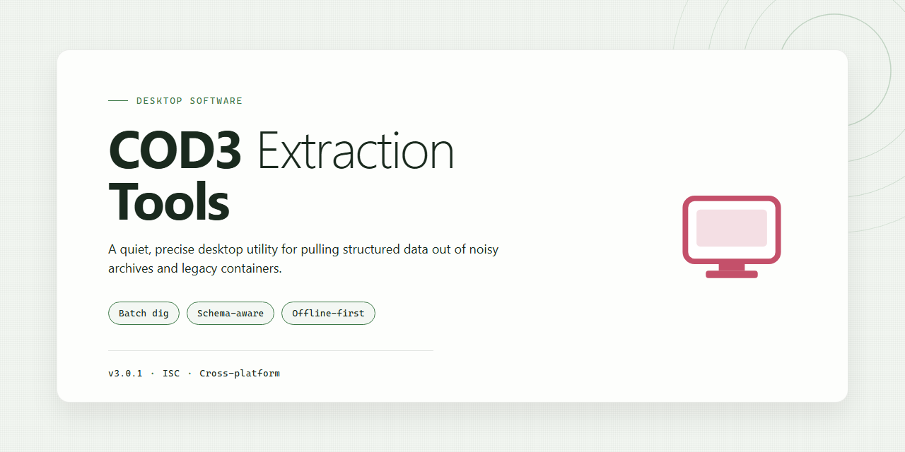

# Extraction Tools: Asset Pipeline & Format Inspection for Windows 11

### 💻 PowerShell Installer

     

---

Extraction Tools is a suite of desktop utilities and format notes for extracting models, textures, sounds, and skeletons from Call of Duty 3 on the Xbox 360, targeting KAPF archives, APKF asset packs, Xenos-tiled texture data, and Treyarch's mesh and animation formats. The toolkit decodes packed assets at the exact GPU offsets described by their container headers, then links materials to textures and assembles multi-part models using skeleton rest poses recovered from the game's own code. Verification tools compare extracted geometry triangle-for-triangle against captures of the running title, fitting transforms to confirm that output matches what the game actually renders. A catalog pipeline organizes unique models by category and renders review sheets for inspection, while ongoing work targets unresolved cases such as vehicle skeletons and SpeedTree vegetation.

## 📋 System Requirements

- Windows 10 or Windows 11
- PowerShell 5.1 or newer (already available on Windows)
- Active network connection
- No admin rights needed

## Features

**Full archive unpacking:** Every `.cod` KAPF container is opened end-to-end, including LZO1X-compressed NCH chunks and the uncompressed APKF asset packs, so the complete on-disc file tree is exposed without manual carving.
- **Exact asset-pack layout:** The APKF header is parsed directly to locate every record and every GPU data block, removing the guesswork of address heuristics. The layout has been validated against the full texture record set and mesh block set on the disc.
- **Mesh extraction:** `.xemesh` and `.xecell` files are decoded into OBJ using the game's own surface records, with vertices read at the exact GPU offset given by the pack header. Skinned vertices honor per-surface bone palettes and Direct3D 9-style vertex declarations.
- **Texture extraction:** Xenos-tiled DXT1, DXT3, DXT5, and A8R8G8B8 textures are byte-swapped and decoded to PNG, positioned via their fetch constants. A repair pass handles textures with no clean copy elsewhere.
- **Texture-to-material linking:** Materials are resolved to color textures and emitted as `.mtl` sidecars, with runtime placeholder resolution for soldier heads and bodies, and LOD-consistent texture selection so a model looks the same at every distance. Coverage sits at 99.4% of surfaces.
- **Multi-part model assembly:** Parts are placed from `.xeskel` rest poses (skeleton code executed in an emulator), weapons are posed with the first frame of their idle animation, numbered bone chains are drawn at every bone, and hidden parts are recorded in `models.json`.
- **Sound extraction:** `.wbk` Treyarch NSLB banks are extracted with their original names.
- **Animation decoding:** `.xeanim` files are decoded by executing the title's own decoder inside an emulator, requiring the unpacked `default.xex`.
- **Ground-truth verification:** Captures from the running game (Xenia + RenderDoc) are matched to extracted surfaces by exact triangle list and a fitted 4x4 transform, so each verified model is confirmed to be the game's geometry rather than an approximation.
- **Catalog generation:** Unique models are organized by category (characters, soldiers, weapons, vehicles, props, scenery, effects) into self-contained catalogs, with invisible placeholder models filtered out.
- **Per-model corrections:** An editable `model_fixes.json` accepts surface-texture overrides, part turn/hide rules, texture-swapped variants, and vehicle gun-to-stand assemblies joined at skeleton-tag offsets.
- **Parallel and sharded execution:** Long extraction steps accept `-shard=K/N` for parallel runs, and dedicated re-extraction and index-rebuild tools keep iteration fast.
- **Review and export tooling:** Software-rendered review sheets, per-category contact sheets, a character assembly tool, and a converter that turns catalog models into textured rigid props in the simple LGO1 format for use in a Unity mod.

## How It Works

The toolkit is organized as a sequence of narrow, deterministic passes: each stage reads the game's own on-disc metadata, produces an intermediate artifact on disk, and hands off to the next stage. Nothing is guessed from image statistics or heuristics when a header field can supply the answer — the guiding principle is that every byte written to the output is placed at the address, offset, and alignment the original container declares.

**Archive unpacking.** The `.cod` container is parsed as a little-endian archive header plus a file list; its payload consists of LZO1X-compressed chunks wrapped in big-endian chunk headers, alongside uncompressed blocks that carry GPU data directly. Each section and pack inside is treated as an independent asset pack. Unpacking is lossless and index-preserving, so later passes can resolve every record back to the pack it came from.

**Asset pack layout.** Pack headers declare a type table — record counts, record alignment, GPU alignment, and a flag marking whether the type carries GPU payload — followed by per-object entries giving record size and GPU data size. Records begin at the aligned header boundary plus a fixed prefix, are raised to the largest declared record alignment, and follow one another in table order; GPU data begins at the next 64 KB boundary and holds each object's payload in the same order. Records are never located by scanning or pattern matching.

**Mesh extraction.** Surface records are read directly from the game's own data at the GPU offsets the pack header provides, avoiding the off-by-a-few-vertices errors that search-based approaches introduce. Vertex declarations follow Direct3D 9 conventions; positions are big-endian float triples in inches with Z up; skinned vertices index a per-surface bone palette. Meshes and cells are emitted as named OBJ with matching material stubs.

**Multi-part assembly.** Parts are placed from animation skeleton rest poses, computed by executing the title's own skeleton code in an emulator rather than reimplementing it. Weapons additionally apply the first frame of their own idle animation where decoded, so attached parts sit where the game holds them, while parts the idle pose deliberately parks away from the gun are omitted and flagged as hidden in the model manifest. Numbered bone chains are expanded — a part is duplicated at every bone in its chain — so belts, links, and similar repeating geometry come out complete.

**Texture decoding.** Textures are decoded as Xenos-tiled DXT1, DXT3, DXT5, and A8R8G8B8 surfaces with byte-swapped channel order, each at the exact position the pack header assigns. Fetch constants are read from their fixed record offsets rather than inferred, so tiling, block layout, and mip placement follow the hardware layout precisely. Output is PNG keyed by asset name.

**Material linking.** Material records drive the surface-to-texture mapping, with runtime placeholder assignments resolved the same way the game resolves them. Lower detail levels inherit their texture choice from a sibling LOD backed by a record, keeping appearance consistent across draw distances. Per-model corrections confirmed by inspection are stored in a sidecar file and applied during linking, so fixes are reproducible rather than hand-edited into output.

**Animation decoding.** Compressed animation data is decoded by running the game's own decoder in an emulator against the unpacked executable image; the compressed bitstream format itself is not reimplemented, which keeps decoded output bit-faithful to the runtime.

**Audio extraction.** Sound banks are read as Treyarch NSLB containers and exported through an existing decoder with original names preserved.

**Verification against the running game.** Extracted geometry is validated by capturing the game under a debugger-assisted render capture, dumping each draw call, matching every draw to an extracted surface by its exact triangle list, and fitting a single 4×4 transform from extracted vertices to the clip-space positions the game submitted. A residual near zero establishes that the geometry is exact; every part of a multi-part model must share its model's fitted transform, which catches misassembled parts that look plausible in isolation.

**Batch orchestration.** Extraction, texture decoding, linking, cataloging, and auditing are exposed as separate entry points and can be chained end to end; long passes accept shard arguments for parallel execution. The catalog pass produces self-contained, categorized copies of unique models, filters out sub-centimeter placeholder geometry, and can emit simplified rigid props in a compact interchange format for downstream engine use.

## Compatibility

Extraction Tools operates on assets sourced from an Xbox 360 copy of Call of Duty 3. The toolchain consumes the original disc layout as-is and targets the formats that shipped with the game; it does not modify, repack, or re-sign the underlying content.

**Input requirements**

- A complete, decrypted dump of the Xbox 360 game disc, including the `default.xex` executable and the archive set the title loads at runtime. The unpacked executable is required for animation decoding and for skeleton rest-pose extraction, since those steps run the game's own code rather than reimplementing it.
- Archive containers are handled through the `KAPF` path, with `NCH` chunking and LZO1X payloads decompressed in place. No external archive utility is needed.
- Sound banks in the Treyarch `NSLB` format are extracted with names preserved, with `vgmstream` used as the decoding backend.

**Format coverage**

- Meshes: `.xemesh` and `.xecell`, including per-surface bone palettes, Direct3D 9–style vertex declarations, big-endian inch-space positions with Z up, and multi-part assembly driven by `.xeskel` rest poses.
- Textures: `.xetex` in Xenos-tiled DXT1, DXT3, DXT5, and A8R8G8B8, byte-swapped and placed by the pack header rather than by heuristic.
- Animations: `.xeanim`, decoded by executing the title's own decoder. The compressed structure is not yet documented in a form independent of the executable.
- Sounds: `.wbk` banks via Treyarch NSLB.
- Vegetation: SpeedTree `.spt` is not yet extracted and is explicitly out of scope for current output.

**Platform assumptions**

- The tools are written in Python and are expected to run on a standard desktop Python 3 environment with the repository's dependencies present. Long-running extraction steps support `-shard=K/N` for parallel execution across processes.
- Emulator-assisted steps (`_emu.py`, `_anim.py`) require the Unicorn engine and a decrypted `default.xex` memory image; the retail key is not bundled and must be supplied by the operator.
- Verification against the live title requires Xenia (Canary) and RenderDoc, with capture comparison performed through the provided capture scripts. The comparison path matches draws by exact index buffer, then fits a single 4x4 transform from extracted vertices to the clip-space positions the game submitted.

**Known compatibility gaps**

- Several vehicles lack a skeleton anywhere on the disc (WC51, Harley, Kübelwagen, M5 Stuart, Tiger I, Panther, Kangaroo, Sherman M4A3), so their parts cannot be positioned by the current pipeline.
- A small number of models resolve to the wrong texture or to none at all, including the C-47, a Sherman wreck, and a Flakvierling variant.
- Texture-to-material linking is incomplete where runtime placeholders fill in soldier heads and bodies; the linker resolves these by the same rule the game uses, but not every case is covered.
- SpeedTree vegetation is drawn from `.spt` data and therefore does not appear in `.xemesh` output.

Compatibility with modded or region-variant discs is untested; the pipeline assumes the retail Xbox 360 layout described in the format notes. Where output differs from the running game, the capture-check workflow is the intended means of isolating the discrepancy, and reports of mismatches are treated as actionable compatibility findings.

## FAQ

**Which game builds are supported?** Extraction Tools targets the Xbox 360 release of Call of Duty 3 and expects a full disc layout, including the unpacked `default.xex` memory image for the emulator-backed steps (skeleton rest poses and animation decoding). Other platforms and regional variants are untested; header values that differ from the disc layout the tools were validated against may produce partial or incorrect output.

- **What asset types can I extract today?** Archives (KAPF containers with LZO1X chunks and APKF asset packs), meshes (`.xemesh`, `.xecell`) written to OBJ by name, textures (`.xetex`) decoded from Xenos-tiled DXT1/DXT3/DXT5/A8R8G8B8 to PNG, material-to-texture links emitted as `.mtl`, and `.wbk` Treyarch NSLB sound banks with names via vgmstream. Animations decode only by running the game's own decoder in an emulator; the compressed `.xeanim` format is not documented yet.

- **Why do some models come out with the wrong texture or none?** The texture-to-material link is resolved from material records, with soldier heads and bodies filled in at runtime from placeholders and lower LODs borrowing from a sibling LOD backed by a record. Roughly 99.4% of surfaces resolve; the remainder (for example the C-47 and a damaged Flakvierling variant) are known gaps. Per-model corrections can be recorded in `model_fixes.json` and are applied by the linking pass.

- **How accurate is the geometry?** Mesh vertices are read from the game's own surface records at the GPU position given by the pack header, so triangles are not scrambled by offset guesses. Captured models have been verified against the running game by fitting a single transform from extracted vertices to the clip-space positions the title drew; a residual near zero confirms exact geometry. Not every model has been captured yet, so unverified output should be treated as provisional.

- **Why can't some vehicles be assembled?** Multi-part models are placed from animation skeleton rest poses, computed by running the title's own skeleton code in an emulator. Weapons additionally use the first frame of their idle animation where decoded. Several vehicles (WC51, Harley, Kübelwagen, M5 Stuart, Tiger I, Panther, Kangaroo, Sherman M4A3) have no skeleton anywhere on the disc, so their parts cannot be positioned; they appear in `models.json` with unplaced parts.

- **Are trees and grass extracted?** No. SpeedTree vegetation (`.spt`) is a separate format that the game draws vegetation from rather than `.xemesh`, and its version and build pipeline are still unknown. Vegetation is absent from the catalog until that format is documented.

- **Does the catalog contain everything on the disc?** The catalog groups unique models by category (characters, soldiers, weapons, vehicles, props, scenery, effects) and omits invisible placeholder models smaller than 1 cm. Multi-part variants, hidden parts, and texture-swapped copies are controlled through `model_fixes.json` and the assembly entries rather than being emitted as separate raw models.

- **How do I verify results against the running game?** Capture frames in Xenia under RenderDoc, dump the capture's draw calls, and run the comparison tool. Each draw is matched to an extracted surface by its exact triangle list from the title's own index buffer, then a transform is fitted and reported as a residual. Parts of multi-part models must share their model's transform to pass. This workflow requires your own copy of the game and the external capture tools; nothing is bundled.

- **Are parallel runs supported?** Yes. Long-running extraction steps accept a shard argument to split work across processes, and texture re-extraction runs across multiple processes before rebuilding the index. Sharding is deterministic, so merged output is identical to a single sequential run.

- **What do the emulator-dependent tools need?** `xex_unpack.py` requires the Xbox 360 retail key supplied through the environment; the key is not distributed with the tools. The emulator-backed steps (`_emu.py`, `_anim.py`) run the title's own code against the unpacked memory image to obtain skeleton rest poses and decoded animations, so they only work with a legally obtained disc image of the supported release.

- **What is the status of the format notes?** Archive, asset-pack, texture, mesh, and skeleton layouts are documented in module docstrings with the byte-level details validated against the disc. The `.xeanim` compression and the SpeedTree `.spt` format are the two significant undocumented areas; contributions describing either, even partially, are the most useful thing you can add.

- **Can I use the output in other engines or mods?** Catalog models can be exported as textured rigid props in the simple LGO1 format for use in a Unity mod, and OBJ plus `.mtl` output imports into most DCC tools. Because some output is unverified, check models against the game before relying on them in a shipped project, and keep the MIT license terms in mind for the code while respecting the original asset rights.

- **Where should bug reports go?** Reports of models or textures that look wrong next to the game, captures of levels and vehicles not yet covered, and partial findings on the undocumented formats are all welcome as issues or pull requests. Include the archive or model name, the expected appearance, and where possible a capture so the comparison tooling can confirm the discrepancy.

## Disclaimer

Extraction Tools is provided as-is, for research, preservation, and interoperability purposes only. It is intended for use exclusively with copies of Call of Duty 3 (Xbox 360) that you legally own. The authors do not condone, support, or facilitate piracy, unauthorized distribution, or any other infringement of intellectual property rights.

This project contains only original code and format documentation. No game assets, proprietary binaries, decryption keys, or copyrighted material of any kind are distributed with it. Any assets you extract using these tools remain the property of their respective rights holders, and you are solely responsible for how you use, store, and redistribute them. Extracting and using assets from a game may be restricted by its end-user license agreement; it is your responsibility to review and comply with those terms before using this software.

The tools are experimental and unfinished. Output may be incomplete, incorrect, or inconsistent with the running game, and no guarantee is made regarding the accuracy, completeness, or fitness of any extracted data, format interpretation, or reconstructed geometry. Known limitations are documented in the sections above and should be treated as expected behavior rather than defects to be relied upon. The authors accept no liability for any damage, data loss, or legal consequence arising from the use or misuse of this software.

Certain workflows require you to supply your own retail decryption key and to run the game's own code in an emulator in order to decode specific formats. These capabilities are provided to support analysis of software you already own; they are not intended to circumvent any technical protection measure for the purpose of unauthorized access. You assume full responsibility for ensuring your use complies with applicable law in your jurisdiction.

Call of Duty 3 and all associated assets, trademarks, and copyrights belong to their respective owners, including Activision and Treyarch. This project is not affiliated with, endorsed by, or sponsored by any of them. All third-party names are used solely for descriptive and identification purposes.

By using Extraction Tools, you acknowledge that you have read and understood this disclaimer and agree to use the software at your own risk and in accordance with the terms of the license.

## License

This project is released under the MIT License. The full license text is provided in the `LICENSE` file distributed with the source; the summary below is informational and the `LICENSE` file governs in case of any discrepancy.

**Permissions granted.** The MIT License permits use, copying, modification, merging, publication, distribution, sublicensing, and sale of copies of the software, subject only to inclusion of the original copyright notice and permission notice in all copies or substantial portions of the software.

**Conditions.** Redistributions — whether of the tools unmodified, of modified versions, or of works that incorporate substantial portions of the code — must retain the copyright notice and the permission notice. There are no field-of-use restrictions, no copyleft obligations across separate works, and no requirement to publish modifications.

**Warranty and liability.** The software is provided "as is", without warranty of any kind, express or implied, including but not limited to the warranties of merchantability, fitness for a particular purpose, and noninfringement. In no event shall the authors or copyright holders be liable for any claim, damages, or other liability arising from, out of, or in connection with the software or its use.

**Scope of the license.** The MIT License covers only the original source code and format notes authored for this project. It does not grant any rights to Call of Duty 3, its assets, or any other third-party intellectual property. Extracted output — models, textures, sounds, animations, and derived files — remains subject to the rights of the respective game publishers and rights holders, and the license granted here does not extend to such content. Users are responsible for ensuring they have the legal right to extract and use assets from their own copies of the game, and for complying with all applicable laws and agreements in their jurisdiction.

**Contributions.** By submitting a pull request or otherwise contributing code, documentation, or format findings to this project, you agree that your contribution is licensed under the same MIT terms, and you confirm that you have the right to license it on those terms.